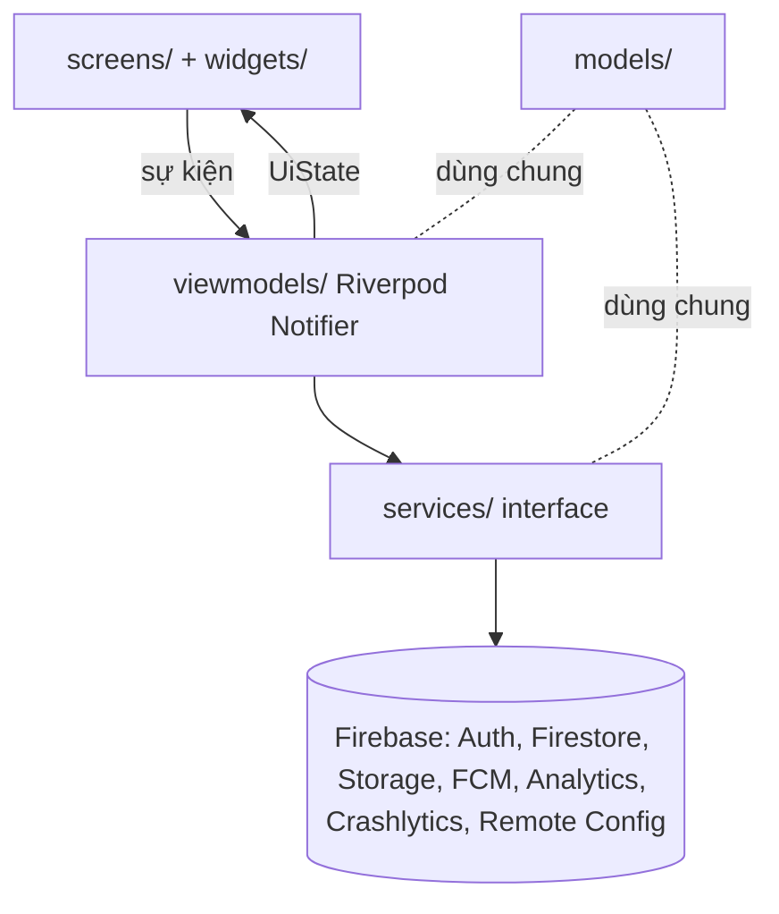
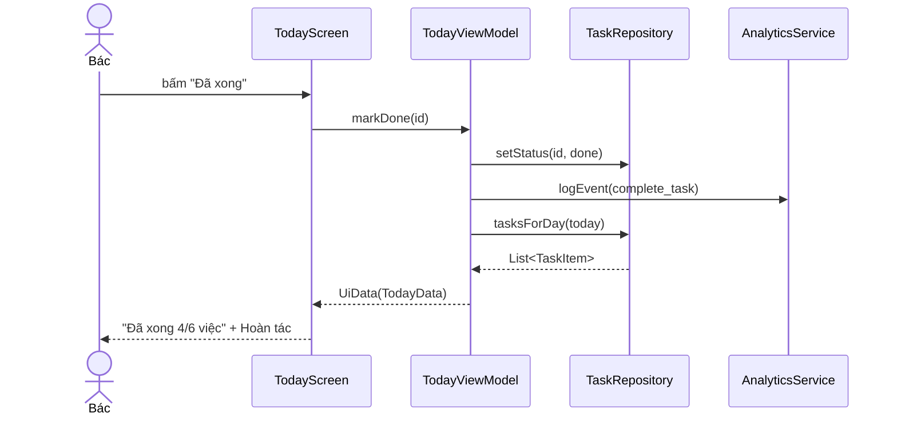

# Kiến trúc – MVVM + Riverpod

Chủ file: Sanh. Sửa file này khi đổi cấu trúc thư mục hoặc thêm ViewModel/service.

## Thư mục

| Thư mục | Chứa gì | Được import |
| --- | --- | --- |
| `lib/models/` | Lớp Dart thuần (TaskItem, Habit, Relative, AppUser, AppNotification), `fromMap/toMap` | không import gì của app |
| `lib/services/` | Interface + bản Firebase + bản Fake cho từng dịch vụ; `providers.dart` chọn bản dùng | `models/`, `utils/` |
| `lib/viewmodels/` | `Notifier` giữ `UiState` (Loading/Empty/Error/Data), gọi service, ghi analytics | `services/`, `models/` |
| `lib/screens/` | Màn hình; chỉ đọc state và gửi sự kiện cho ViewModel | `viewmodels/`, `widgets/`, `theme/` |
| `lib/widgets/` | Component Lab 2 dùng chung (AppButton, AppBackBar, state views, AppShell…) | `theme/` |
| `lib/theme/` | Token: `AppColors`, `HabitPalette`, `AppSpacing`, `AppRadius`, `AppSizes`, `AppTheme` | — |
| `lib/router/` | `go_router`, chặn màn khi chưa đăng nhập | `screens/`, `viewmodels/` |
| `lib/utils/` | `AppException` (lỗi đã dịch sang câu cho Bác) | — |

## Sơ đồ lớp

## Luồng mẫu: Đánh dấu "Đã xong" ở Hôm nay

## ViewModel ↔ service

| ViewModel | Feature | Service dùng |
| --- | --- | --- |
| `SignInViewModel` | F1 | AuthService, AnalyticsService, CrashService |
| `TodayViewModel` | F3 | TaskRepository, AnalyticsService, CrashService |
| _(thêm khi làm)_ | | |

## Luật (bị chấm – đề Lab 3 mục 5)

1. Widget không gọi `FirebaseAuth.instance`, `FirebaseAnalytics.instance`, `http`…
2. Logic nằm trong ViewModel/service, không nằm trong `build()`.
3. Mỗi màn tải dữ liệu có `UiState` riêng.
4. Service tiêm qua `providers.dart`; test ViewModel bằng `overrideWithValue(Fake…)`.
