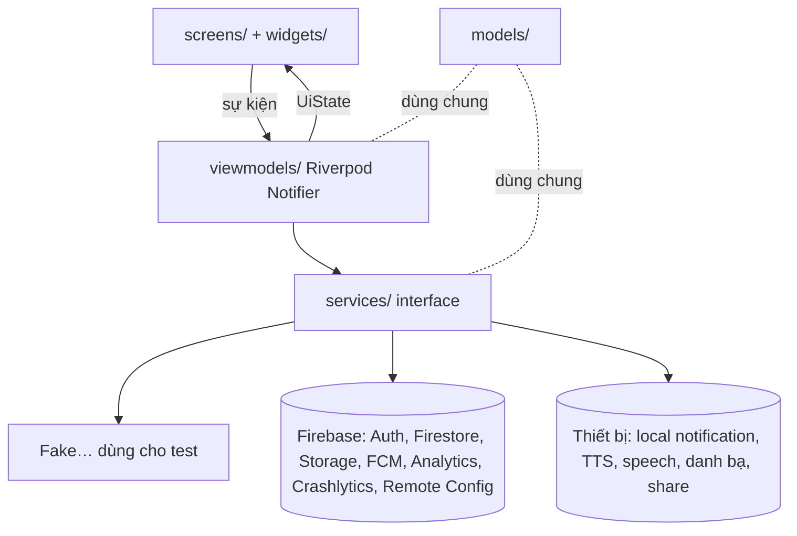
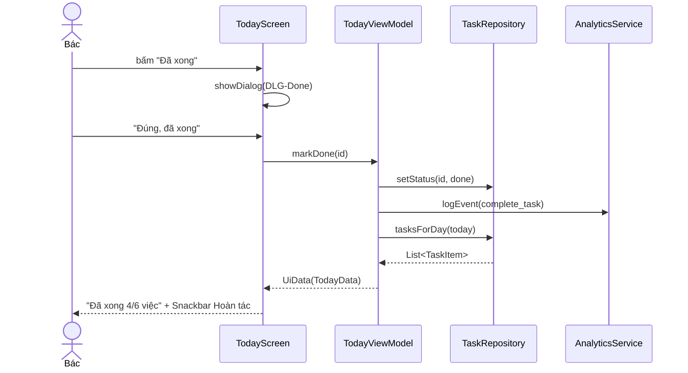
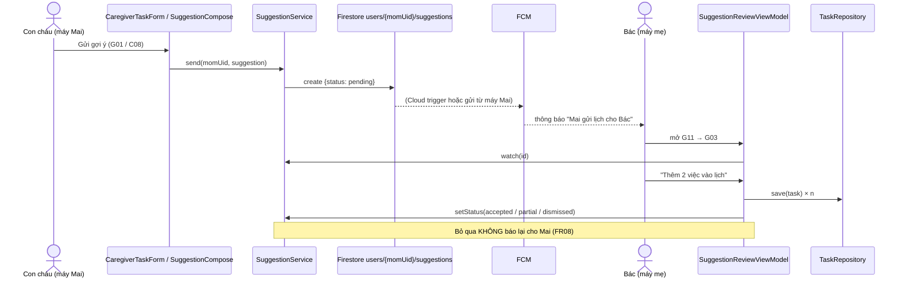

# Kiến trúc – MVVM + Riverpod

Chủ file: **Sanh**. Sửa file này khi đổi cấu trúc thư mục, thêm ViewModel / service hoặc đổi dữ liệu Firestore. Bản Firebase của service do **Hiếu** viết.

Nguồn: `lab2/flutter-handoff.md` (route map, Bảng 1 token, Bảng 2 component), `lab2/PRD.md` (FR / NFR), `lab2/user-flow.md` (IA 2 chế độ), code hiện có trong `lib/`.

## 1. Tổng quan

- App Android 360 × 800 dp, **hai chế độ** chọn ở C01: **Bác** (người lớn tuổi, 4 tab) và **Con cháu** (ghép nối, lập lịch cho mẹ, gửi gợi ý).
- **MVVM**: View (`screens/`, `widgets/`) ↔ ViewModel (Riverpod `Notifier` giữ `UiState`) → Service (interface) → Firebase.
- Mỗi service có **2 bản**: `Fake…` (chạy ngay, dùng cho test và khi chưa nối Firebase) và `Firebase…` (Hiếu viết). Chọn bản ở **một chỗ duy nhất**: `lib/services/providers.dart`.
- Dữ liệu: Firestore (bật offline persistence → dùng được khi mất mạng, FR13), Storage cho PDF, FCM + local notification cho lời nhắc / gợi ý.

## 2. Thư mục

| Thư mục | Chứa gì | Được import | Chủ |
| --- | --- | --- | --- |
| `lib/models/` | Lớp Dart thuần, `fromMap/toMap` | không import gì của app | Hiếu |
| `lib/services/` | Interface + `Fake…` + `Firebase…`; `providers.dart` chọn bản dùng | `models/`, `utils/` | Hiếu |
| `lib/viewmodels/` | `Notifier` giữ `UiState`, gọi service, ghi analytics | `services/`, `models/`, `utils/` | người làm feature |
| `lib/screens/<feature>/` | Màn hình; chỉ đọc state và gửi sự kiện cho ViewModel | `viewmodels/`, `widgets/`, `theme/` | người làm feature |
| `lib/widgets/` | Component Lab 2 dùng chung (mục 9) | `theme/` | Sanh (F0) |
| `lib/theme/` | Token: `AppColors`, `HabitPalette`, `AppSpacing`, `AppRadius`, `AppSizes`, `AppTheme` | — | Sanh (F0) |
| `lib/router/` | `go_router`, khai báo route (Sanh); điều kiện chặn đăng nhập / vai trò (Hiếu) | `screens/`, `viewmodels/` | Sanh + Hiếu |
| `lib/utils/` | `AppException` (lỗi đã dịch sang câu cho Bác) | — | Hiếu |
| `test/` | Test ViewModel bằng service giả | — | mỗi người |
| `e2e_test/` | ARTEMIS (pytest) | — | Hương điều phối |
| `firebase/` | `firestore.rules`, `storage.rules`, `remote-config-defaults.json` | — | Hiếu |

## 3. Sơ đồ lớp



## 4. Luồng mẫu: Đánh dấu "Đã xong" ở Hôm nay (chỉ số M1 ≤ 2 chạm)



## 5. Luồng gợi ý lịch giữa 2 máy (F12 + F13 + F14)



## 6. Trạng thái màn (`UiState`) – bị chấm

```dart
sealed class UiState<T> {}            // lib/viewmodels/ui_state.dart
final class UiLoading<T> ...          // LoadingView
final class UiEmpty<T>   ...          // EmptyView (vd. ST-Empty)
final class UiError<T>   ...          // ErrorView + "Thử lại" (message lấy từ AppException.userMessage)
final class UiData<T>    ...          // nội dung
```

Màn dùng `switch (state)` để vẽ đủ 4 trạng thái. Hành động một lần (lưu, xoá, dời…) trả về kết quả cho View để hiện Snackbar / điều hướng; không để View tự gọi service.

## 7. Điều hướng

### 7.1 Điều kiện chặn (redirect) – Hiếu viết, Sanh khai báo route

| Điều kiện | Đi tới |
| --- | --- |
| Chưa đăng nhập | `/sign-in` (A01) |
| Đã đăng nhập, chưa chọn vai trò (`users/{uid}.role == null`) | `/role` (C01) |
| Vai trò Bác, chưa onboarding (`onboarded == false`) | `/welcome` (S01) |
| Vai trò Con cháu, chưa ghép nối | `/caregiver/pair` (C02) |
| Còn lại | Bác → `/today`; Con cháu → `/caregiver/schedule` |

### 7.2 Route map (theo `lab2/flutter-handoff.md`, chỉnh cho Lab 3)

| Route | Màn | Feature | Trong `app_router.dart` |
| --- | --- | --- | --- |
| `/sign-in` | A01 | F1 | có |
| `/role` | C01 | F1 | placeholder |
| `/welcome` · `/setup` · `/setup/notifications` | S01 · S02 · S13 / S13d | F2 | placeholder |
| `/setup/try-reminder` · `/setup/first-task` | N01–N03 · N04 → N05 → N18 → N19 | F2 | placeholder |
| `/today` (tab 0) | S03 + mọi state S03-*, ST-Empty, N17, G11 / G12 | F3 | có |
| `/today/task/:id` · `/today/task/:id/edit` | S04 · S15 | F3 · F4 | placeholder |
| `/today/add` · `/today/add/time` · `/today/add/result` | S05 · S06 · ST-Loading / Saved / Error, N16 | F4 | placeholder |
| `/task/date` · `/task/repeat` · `/task/scope` | N11 · N12 · N13 (màn con, `pop(result)`) | F4 | placeholder |
| `/today/voice` | V00–V05 | F5 | placeholder |
| `/today/all` | S11 chế độ hôm nay | F7 | placeholder |
| `/today/suggestions/:id` | G03–G09 | F12 | placeholder |
| `/reminder/:taskId` | S14 (mở từ notification `fullScreenIntent`; `?preview=true` từ S10) | F6 | placeholder |
| `/week` (tab 1) · `/week/:date` · `/week/:date/task/:id` | S07 · S11 / S11b · S04 | F7 | placeholder |
| `/habits` (tab 2) · `/habits/:key` | S08 · S16 | F9 | placeholder |
| `/family` (tab 3) · `/family/add` · `/family/:personId/edit` · `/family/:personId/share` | S09 · S12 · N09 · S17 | F11 | placeholder |
| `/settings` · `/settings/profile` | S10 · N06 (+ khu demo F10) | F8 | placeholder |
| `/settings/reminders` · `/settings/help` · `/settings/data` | N07 · N08 · N20 | F6 · F8 · F8 | placeholder |
| `/inbox` | Hộp thông báo | F10 | placeholder |
| `/caregiver/pair` | C02 / C02e | F13 | placeholder |
| `/caregiver/schedule?view=day\|week\|month` | C03 / C04 / C05 | F14 | placeholder |
| `/caregiver/task/new` → `/repeat` → `/review` → `/caregiver/task/sent` | C06 → C07 → C08 (+ C08w) → C09 | F14 | placeholder |
| `/caregiver/task/:id` | C10 (+ C11, C12 dialog) | F14 | placeholder |
| `/caregiver/suggest` | G01 → G02 | F12 | placeholder |

Việc của F0 (Sanh) – đã làm ở bước 01 (02/11/2026): mọi route trên đã khai báo trong `app_router.dart`, màn chưa làm là `FeaturePlaceholder` ghi mã màn · feature · người theo bản chia task 02/11; nhóm route theo feature bằng comment `// F<số> <tên> – <người>`. `/caregiver/schedule` chọn C03 / C04 / C05 theo query `view`. Kiểm tra bằng `test/router_test.dart`.

Quy tắc điều hướng từ handoff: tab dùng `StatefulShellRoute`; Back hệ thống ở S03 thoát app; kết quả lưu (`/today/add/result`) dùng `go` (thay thế, không chồng); màn con N11–N13 trả kết quả bằng `pop(result)`; S04 mở từ 2 nơi nên nút Back ghi "Quay lại".

## 8. Service

### 8.1 Đã có (interface + Fake trong `lib/services/`)

| Service | Hàm chính | Bản Firebase (Hiếu) |
| --- | --- | --- |
| `AuthService` | `authStateChanges()`, `signInWithGoogle()`, `signOut()` | Firebase Auth + google_sign_in |
| `TaskRepository` | `tasksForDay(day)`, `save(task)`, `setStatus(id, status)`, `delete(id)` | Firestore `users/{uid}/tasks` |
| `HabitRepository` | `all()`, `byKey(key)` | Firestore `habits` (nạp sẵn 9 thói quen) |
| `FamilyRepository` | `all()`, `save(relative)`, `delete(id)` | Firestore `users/{uid}/family` |
| `AnalyticsService` | `logEvent(name, params)`, `setUserId(uid)` | Firebase Analytics |
| `CrashService` | `recordError`, `setCustomKey`, `setUserId`, `testCrash` | Crashlytics |
| `RemoteConfigService` | `init()`, `getInt`, `getBool`, `onUpdated` | Remote Config |
| `MessagingService` | `requestPermission()`, `inbox()`, `onOpened` | FCM + `users/{uid}/notifications` |
| `ReportService` | `exportWeek(weekStart)` → `Stream<UploadProgress>` | package `pdf` + Storage `reports/{uid}/` |

### 8.2 Cần thêm (người làm feature thêm interface + Fake, Hiếu viết bản Firebase)

| Service | Hàm đề xuất | Dùng cho | Nền tảng |
| --- | --- | --- | --- |
| `TaskRepository` (bổ sung) | `tasksInRange(from, to)`, `postpone(id, to)`, `undo(change)`, `softDelete(id, scope)` | F3, F4, F7, F9 | Firestore |
| `SettingsService` | `watch()`, `setFontScale`, `setHighContrast`, `setReadAloud`, `setVibrate` | F2 (S01), F8 (S10), F6 (N07) | Firestore `users/{uid}` + cache máy |
| `ProfileService` | `watch()`, `save(profile)`, `setRole(role)`, `markOnboarded()` | F1 (C01), F2 (S02), F8 (N06) | Firestore `users/{uid}` |
| `ReminderService` | `requestPermission()`, `schedule(task)`, `cancel(id)`, `snooze(id, minutes)`, `showTest()` | F2 (S13, N01), F4 (N16), F6 | flutter_local_notifications |
| `SpeechService` | `listen()` → text, `parse(text)` → `TaskDraft`, `speak(text)` | F5, đọc to ở S04 / S14 / S16 | speech_to_text, flutter_tts (`vi-VN`) |
| `SuggestionService` | `send(momUid, s)`, `watchPending()`, `byId(id)`, `accept(id, items)`, `dismiss(id)`, `undoDismiss(id)` | F12, F14 (C08) | Firestore `users/{momUid}/suggestions` + FCM |
| `PairingService` | `createCode()` (máy mẹ), `pair(code)` (máy con cháu), `pairedMom()` | F13 | Firestore `pairings/{code}` (hết hạn 10 phút) |
| `CaregiverScheduleService` | `tasksOfMom(range)`, `checkConflict(draft)`, `recurringDetail(id)`, `updateRecurring(id, scope)`, `stopRecurring(id)` | F14 | Firestore `users/{momUid}/tasks` (quyền qua ghép nối) |

Thêm package không phải Firebase (speech_to_text, flutter_tts, pdf, share_plus, url_launcher, flutter_contacts, permission_handler, flutter_local_notifications): người làm feature đề xuất trong PR; package Firebase: Hiếu thêm.

## 9. ViewModel ↔ service (đề xuất cho toàn bộ màn)

Mỗi ViewModel còn dùng `AnalyticsService` (ghi event) và `CrashService` (lỗi thật). Cột "Có sẵn" = đã có file trong `lib/viewmodels/`. ViewModel dùng chung giữa nhiều feature có **một chủ**; người khác thêm state qua PR và nhờ chủ duyệt.

| ViewModel | Feature | Người | Màn / state | Service | Có sẵn |
| --- | --- | --- | --- | --- | --- |
| `SessionViewModel` | F1 | Hiếu | (toàn app – theo dõi đăng nhập) | AuthService | ✅ |
| `TodayViewModel` | F3 (chủ), F2, F4, F6 thêm state | Khang (chủ) | S03, N19, S03b, S03-alldone, N17, ST-Empty, DLG-Done, DLG-Later, DLG-Skip, S03-later, S03-later4, S03-tomorrow, S03-skip, S03-edited, S03-deleted, S03-snooze | TaskRepository, ReminderService | ✅ |
| `SignInViewModel` | F1 | Hiếu | A01, A02, A02e, A03, A04 | AuthService | ✅ |
| `RoleViewModel` | F1 | Hiếu | C01 | ProfileService |  |
| `OnboardingViewModel` | F2 | Hương | S01, S02, DLG-WakeTime, S13, S13d | SettingsService, ProfileService, ReminderService |  |
| `TryReminderViewModel` | F2 | Hương | N01, N02, N03 | ReminderService |  |
| `FirstTaskViewModel` | F2 | Hương | N04, N05, N18 | TaskRepository |  |
| `TaskDetailViewModel` | F3 | Khang | S04 | TaskRepository |  |
| `TaskFormViewModel` | F4 | Khang | S05, S06, S06e, S06o, ST-Validation, DLG-TaskTime, N11, N12, N13, N14, ST-Loading, ST-Loading-offline, ST-Saved, ST-Error, N16, S15, DLG-Delete | HabitRepository, TaskRepository, CrashService, ReminderService |  |
| `VoiceAddViewModel` | F5 | Khang | V00, V01, V02, V03, V04, V05 | SpeechService, RemoteConfigService, TaskRepository |  |
| `ReminderViewModel` | F6 | Khang | S14 | ReminderService, RemoteConfigService |  |
| `ReminderSettingsViewModel` | F6 | Khang | N07 | ReminderService, SettingsService |  |
| `WeekViewModel` | F7 | Hương | S07 | TaskRepository, ReportService |  |
| `DayDetailViewModel` | F7 (chủ), F12 thêm state G08* | Hương (chủ) | S11, S11b, G08, G08b, G08c, G08d | TaskRepository |  |
| `SettingsViewModel` | F8 | Sanh | S10 | SettingsService, AuthService |  |
| `ProfileViewModel` | F8 (chủ), F10 thêm khu demo | Sanh (chủ) | N06 | ProfileService |  |
| `HabitsViewModel` | F9 | Hương | S08 | HabitRepository, TaskRepository |  |
| `HabitDetailViewModel` | F9 | Hương | S16 | HabitRepository, TaskRepository |  |
| `FamilyViewModel` | F11 | Hương | S09, S09b, N21 | FamilyRepository, SuggestionService |  |
| `RelativeFormViewModel` | F11 | Hương | S12, S12a, S12e, N09, N15 | FamilyRepository |  |
| `ShareMessageViewModel` | F11 | Hương | S17, S17b, N10 | FamilyRepository, TaskRepository |  |
| `SuggestionComposeViewModel` | F12 | Sanh | G01, G01b, G02 | SuggestionService |  |
| `SuggestionReviewViewModel` | F12 | Sanh | G03, G03b, G04, G05, G05b, G06, G07, G07b, G09 | SuggestionService, TaskRepository |  |
| `SuggestionInboxViewModel` | F12 | Sanh | G10, G11, G12 | SuggestionService |  |
| `PairingViewModel` | F13 | Hiếu | C02, C02e | PairingService |  |
| `MomScheduleViewModel` | F14 | Hiếu | C03, C04, C05 | CaregiverScheduleService |  |
| `CaregiverTaskFormViewModel` | F14 | Hiếu | C06, C06e, C07, C07m, C08, C08w, C09 | CaregiverScheduleService, SuggestionService |  |
| `RecurringTaskViewModel` | F14 | Hiếu | C10 | CaregiverScheduleService |  |

## 10. Dữ liệu Firestore (Hiếu chốt; người làm feature đề xuất trường mới trong PR)

| Đường dẫn | Trường chính | Ai đọc / ghi | Feature |
| --- | --- | --- | --- |
| `users/{uid}` | `role` (`elder` / `caregiver`), `displayName`, `honorific` (Ông / Bà / Bác), `wakeTime`, `onboarded`, `fontScale` (1.0 / 1.15 / 1.3), `highContrast`, `readAloud`, `vibrate`, `pairedMomUid` (máy con cháu), `fcmTokens[]` | chủ tài khoản | F1, F2, F8 |
| `users/{uid}/tasks/{taskId}` | `title` (≤ 80), `habitKey`, `hour`, `minute`, `startDate`, `repeat` (`once` / `daily` / `someDays`) + `weekdays[]` hoặc `rrule` (việc con cháu lập, RFC 5545), `durationMin`, `remind`, `remindBeforeMin`, `createdBy`, `deletedAt` (xoá mềm 7 ngày) | chủ; con cháu đã ghép nối **đọc** | F3, F4, F5, F7, F14 |
| `users/{uid}/completions/{date_taskId}` | `taskId`, `date`, `status` (done / postponed / skipped), `postponedTo`, `reason`, `at` | chủ; con cháu đã ghép nối **đọc** (C10 "6 lần gần nhất") | F3, F6, F9, F14 |
| `users/{uid}/family/{personId}` | `name`, `relation` (Con / Cháu / Bạn bè / Khác), `phone`, `quickCall`, `lastCalledAt` | chủ | F11 |
| `users/{uid}/notifications/{id}` | `title`, `body`, `receivedAt`, `route`, `read` | chủ | F10 |
| `users/{momUid}/suggestions/{id}` | `fromUid`, `fromName`, `message`, `items[{title, habitKey, date, hour, minute, durationMin}]`, `status` (pending / accepted / partial / dismissed), `popupShown`, `createdAt` | con cháu đã ghép nối **tạo**; mẹ đọc + cập nhật | F12, F14 |
| `pairings/{code}` | `momUid`, `expiresAt` (+10 phút), `usedBy` | máy mẹ tạo; con cháu đọc 1 lần khi nhập mã | F13 |
| `habits/{key}` | `name`, `description`, `order`, `origin` (Blue Zones), `suggestions[]` | ai đăng nhập cũng đọc; không ai ghi từ app | F9 |
| Storage `reports/{uid}/{week}.pdf` | PDF ≤ 5 MB | chủ | F7 |

9 khoá thói quen: `move`, `purpose`, `downshift`, `eighty`, `plant`, `tea`, `belong`, `family`, `tribe` (tên hiển thị theo `lab2/vocabulary.md`, màu theo `HabitPalette`).

**Rules hiện tại** (`firebase/firestore.rules`) chỉ cho chủ tài khoản. **TODO(Hiếu)**: thêm `pairings`, `completions`, quyền đọc `tasks` / `completions` và tạo `suggestions` cho người đã ghép nối (F13 "Xong khi": người lạ không đọc được lịch của mẹ).

## 11. Remote Config (`firebase/remote-config-defaults.json`)

| Khoá | Mặc định | Dùng ở | Demo trên console |
| --- | --- | --- | --- |
| `snooze_minutes` | 10 | S14 "Nhắc lại sau N phút", S03-snooze | đổi 10 → 15, nút S14 đổi theo |
| `voice_input_enabled` | true | nút "Nói việc" ở S05 (F5) | tắt → nút biến mất, không build lại |
| `home_max_upcoming` | 6 | số việc tối đa ở S03 | — |

## 12. Theme (F0 – Sanh)

Token lấy từ `lab2/design-tokens.md` (bảng `colors`, `typography`, `spacing`, `rounded`) và `lab2/flutter-handoff.md` › Bảng 1. File trong `lib/theme/`:

| File | Nội dung |
| --- | --- |
| `app_colors.dart` | `AppColors` (đủ màu DESIGN.md, thêm `success`, `warningStrong`, `shadowLevel1/2`), `AppColorsHighContrast`, `HabitPalette` (9 màu + `onAccent` trắng) |
| `app_spacing.dart` | `AppSpacing` (4…48, `screen` 20, `betweenTargets` 20), `AppRadius` (8, 12, 14, 16, 24, `full` 999 + `…All`), `AppSizes` (`minTarget` 72, `icon` 32, `habitIcon` 48, `accentBar` 6, `border` 2, `appBar` 88, `navBar` 96…) |
| `app_theme.dart` | `AppTheme.light()`, `AppTheme.highContrast()` (cùng hàm dựng, chỉ đổi `ColorScheme`), `AppText.bodyLgStrong`, `AppText.numericLg` |
| `display_settings.dart` | `AppFontScale { vua 1.0, lon 1.15, ratLon 1.3 }`, `fontScaleProvider` (mặc định `lon` theo Figma S01/S10), `highContrastProvider` (mặc định tắt), `maxTextScale` 2.0 – giữ trong bộ nhớ, F8 nối `SettingsService` |
| `app_icons.dart` | `AppIcons`: 22 icon khung Components (`138:2`) + 4 icon tab → `IconData` Material gần nhất (DT-09) |

Chữ (Be Vietnam Pro, bundle trong `assets/fonts/`, khai báo ở `pubspec.yaml`): `display` 34 · `headline` 30 · `title-md` 26 · `title-lg` 24 · `body-lg` 24 · `label-btn` 22 · `body-md` / `caption` / `label-nav` 20. Cả 15 kiểu của `TextTheme` đều được điền nên không có chữ < 20 sp (kể cả widget Material dùng `labelSmall`, `titleSmall`).

Cỡ chữ người dùng chọn (S01 / S10) = `textScaler` 1.0 / 1.15 / 1.3 toàn app, nhân với cỡ chữ hệ thống, trần 2.0 (`lib/app.dart` › `builder`). Đổi `fontScaleProvider` là cả app đổi ngay. Tương phản cao (S10) = `AppTheme.highContrast()`: nền trắng, chữ chính `#0F1411` (18.6 : 1), chữ phụ `#202B25` (14.7 : 1), nút `#174C37` (chữ trắng 9.9 : 1), lỗi `#912018` – chỉ dùng lại màu có trong DESIGN.md.

Màn và widget lấy màu qua `Theme.of(context).colorScheme` (để tương phản cao có tác dụng), không đọc `AppColors` trực tiếp.

## 13. Widget dùng chung (F0 – Sanh) – theo `lab2/flutter-handoff.md` › Bảng 2

| Widget | Dùng ở | Trạng thái |
| --- | --- | --- |
| `AppButton` (`AppButtonKind`: primary / secondary / tonal / text / danger / dangerOutline; cao ≥ 72, icon + chữ, `busy`) | mọi màn | có |
| `AppBackBar` (Back có chữ · + `step` "Bước x/y" · + `trailing`, vd. `AppBarEditButton` "Sửa" ở S04) | màn cấp 2–3 | có |
| `AppShell` (bottom nav 4 tab có nhãn, cao 96, `maxLines: 1`; icon `AppIcons.tab…`) | 4 tab | có |
| `LoadingView` (`message`, `hint`) / `EmptyView` (`icon`, `title`, `message`, `action`, `secondaryAction`) / `ErrorView` (`message`, `onRetry`, `title`, `detail`, `extraActions`; luôn có "Thử lại", `liveRegion`) – khớp ST-Loading / ST-Empty / ST-Error | mọi màn tải dữ liệu | có |
| `IconCircle` (icon 64 trong vòng tròn nền nhạt; `danger` = nền `errorContainer`) | đầu hộp thoại, ST-*, màn "Đã lưu / Đã gửi" | có |
| `FeaturePlaceholder` | màn chưa làm | có |
| `NextTaskCard`, `TaskRow` (Upcoming / Done / Skipped) | S03, S11, S16, C03 | cần làm |
| `HabitBadge` / `HabitTile` (icon + tên + màu nhấn) | S04, S05, S08, S16, C06 | cần làm |
| `TimeField` + `showTimeWheel()` (DLG-TaskTime / DLG-WakeTime: 3 cột giờ / phút / sáng-chiều, Hủy / Xong) | S02, S06, S15, N05, C06 | cần làm |
| `showConfirmDialog<T>(context, icon, title, message, details, options: [ConfirmOption(label, icon, value, kind)], danger)` + `ConfirmDetail` (dòng icon + chữ) – nút xếp dọc full-width theo thứ tự `options`, cách nhau 20; huỷ ở cuối, trừ khi hậu quả khó lấy lại thì nút an toàn là nút chính ở trên (SG-19); chạm ngoài / Back trả `null` | DLG-Done / Later / Skip / Delete, N13, N14, N15, C08w, C11, C12 | có |
| `showUndoSnackbar(context, title, subtitle, onUndo)` (2 tầng chữ, hàng nút "Đóng" · "Hoàn tác", `persist: true` – không tự tắt, `liveRegion`) | S03-*, G09, C12 | có |
| `AppTextField` (nhãn ngoài ô, gợi ý "Ví dụ…", `errorText` có icon, `liveRegion`) | S02, S06, S12, C06 | cần làm |
| `SwitchRow`, `ChoiceCard` (radio / segmented cao ≥ 52) | S01, S10, S12, C07 | cần làm |
| `ReadAloudButton` ("🔊 Đọc to", gọi `SpeechService.speak`) | S04, S14, S16 | cần làm |
| `SuggestionCard` (thẻ G12 ở đầu S03) | S03 (F3 chỉ đặt widget, F12 làm nội dung) | cần làm |

Màn của mọi người **chỉ** dùng widget ở đây. Thiếu widget → báo Sanh, không tự làm bản riêng trong thư mục màn.

## 14. Lỗi, mất mạng, Crashlytics

- Service bắt exception của SDK → ném `AppException` (câu cho Bác, đã có `network`, `cancelled`, `unknown`). ViewModel chỉ đọc `userMessage`.
- Lỗi thật (lưu việc thất bại, upload PDF lỗi) → `CrashService.recordError(…, reason)` = non-fatal (F4, F7). Nút "Thử crash" chỉ ở khu demo F10.
- Mất mạng: Firestore offline persistence vẫn ghi được; màn lưu hiện ST-Loading-offline rồi ST-Saved khi có mạng, hoặc ST-Error sau thời gian chờ, giữ nguyên nội dung đang nhập (`lab2/flutter-handoff.md` › ST-Error).
- Mọi thay đổi có "Hoàn tác"; xoá / ngưng lịch phải hỏi lại và nói rõ hậu quả (NFR11).

## 15. Luật (bị chấm – đề Lab 3 mục 5)

1. Widget không gọi `FirebaseAuth.instance`, `FirebaseFirestore.instance`, `FirebaseAnalytics.instance`, `http`…
2. Logic nằm trong ViewModel / service, không nằm trong `build()`.
3. Mỗi màn tải dữ liệu có `UiState` riêng (Loading / Empty / Error / Data).
4. Service tiêm qua `providers.dart`; test ViewModel bằng `overrideWithValue(Fake…)`.
5. Không màu, cỡ chữ, khoảng cách viết cứng – chỉ dùng `lib/theme/` (F0 "Xong khi").
6. Câu chữ theo `lab2/AppStyleGuide.md` + `lab2/vocabulary.md`; luật thiết kế theo `lab2/rule.md`.
