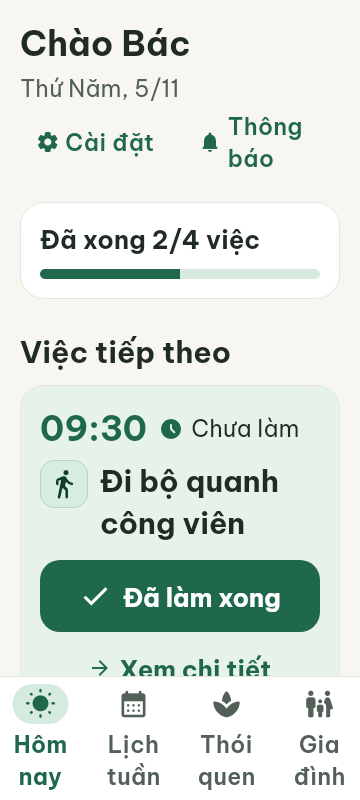
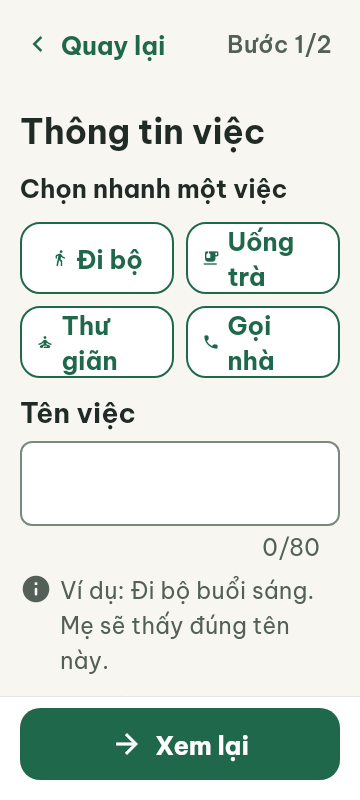
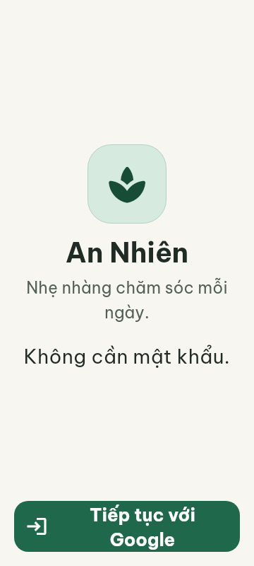
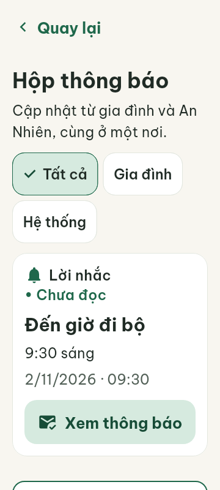

# Định hướng và thay đổi UI/UX — 05/11/2026

## Mục tiêu và toàn bộ gợi ý đã bàn

- Đẹp, thoáng, to, rõ, dễ nhìn; cảm giác ấm áp, nhẹ nhàng, đơn giản và tôn trọng người lớn tuổi. Nền kem sáng, xanh lá trầm, thẻ sáng ít bóng, biểu tượng nét rõ, màu ấm nhấn nhẹ, tương phản tốt.
- Chữ dễ đọc, vùng chạm lớn, các nút cách nhau đủ xa; cả hàng bấm được. Thiết kế cho lúc mắt mỏi, tay run hoặc đang vội; không phụ thuộc nhấn giữ.
- Mỗi màn có một hành động chính nổi bật. Nhóm nội dung ngắn, có khoảng nghỉ; tránh nhiều viền, màu, thẻ lồng nhau và hiệu ứng.
- Mở app biết ngay việc tiếp theo: giờ, tên việc, nút hành động lớn. Việc đã xong/chưa tới giờ phía dưới; không bắt đọc cả danh sách.
- Hiển thị vừa đủ trước; ghi chú, lịch lặp, người tạo mở trong chi tiết. Không thu nhỏ chữ để nhét nội dung.
- Giảm gõ: mẫu hoạt động, lựa chọn nhanh, giờ gợi ý, tự điền dữ liệu cũ, nhớ lựa chọn phù hợp lần trước. Luôn có nhập riêng; tùy chỉnh ít dùng mở sau.
- Luồng thêm việc mong muốn: chọn mẫu → chọn giờ → lưu. Với thông tin sức khỏe, không tự suy diễn liều thuốc; vẫn cần nhập/xem lại thông tin chính xác.
- Nhãn nút mô tả kết quả: “Lưu lịch nhắc”, “Đã uống thuốc”, “Nhắc lại sau 10 phút”, hạn chế “OK” và “Xác nhận”.
- Việc thường ngày một chạm, phản hồi ngay và có “Hoàn tác”. Không xác nhận mọi lần; xóa dữ liệu, bỏ liên kết, đổi lịch quan trọng cần rõ hậu quả/phạm vi.
- Vuốt dọc xem nội dung; ngang có thể đổi ngày khi có lịch thật. Có nút mũi tên thay thế và dấu hiệu nhận biết. Không vuốt để xóa ngay, không dùng cùng cử chỉ với ý nghĩa bất nhất.
- Phản hồi có chữ và dấu tích; không chỉ đổi màu. Rung nhẹ nếu đã bật; hạn chế popup chắn màn hình, lời chúc mừng và hiệu ứng cho việc nhỏ.
- Nhất quán vị trí lưu/quay lại, cách chọn giờ. Điều hướng dưới 3–4 mục có chữ và biểu tượng; giữ vị trí khi chuyển tab.
- Cho đổi ý dễ: giữ bản nháp khi đi lại giữa các bước, tự điền khi sửa; tránh nhập lại.
- Trạng thái dùng cả chữ và hình: sắp tới, đã xong, đã lỡ/đã bỏ qua/đã dời giờ. Quá giờ có “Làm ngay”, “Đổi giờ”; không tự coi quá giờ là đã bỏ qua.
- Thông báo có nút hoàn thành/nhắc sau nếu nghiệp vụ hỗ trợ, giảm phải mở app.
- Tách vai trò: Bác thấy việc cần làm; người thân thấy hỗ trợ/theo dõi.
- Màn trống hướng dẫn thêm việc đầu tiên, tốt hơn nữa có mẫu chọn.
- Ngôn ngữ nhẹ nhàng, không trách móc khi chưa hoàn thành; không chúc mừng quá mức.
- Mạng yếu: phản hồi khi bấm, chống bấm lặp, giữ nội dung và báo chưa lưu/chưa đồng bộ đúng thực tế; không báo thành công trước khi lưu.
- Hỗ trợ chữ lớn và tương phản cao toàn app.
- Ưu tiên xem xét ba tình huống: mở app buổi sáng, thêm lịch, bỏ lỡ lời nhắc. Đánh giá qua tác vụ thực tế trước khi thêm tính năng.

## Triển khai trong đợt này

- Theme nền kem; góc nút/thẻ mềm hơn, section card thoáng hơn; app bar không đổi sắc khi cuộn. Giữ chữ tối thiểu 20sp, vùng chạm tối thiểu 72dp và bảng màu tương phản cao.
- Hôm nay: tiêu đề tự xuống dòng, tiến độ bằng chữ + thanh; nổi bật việc tiếp theo, tách các việc còn lại, nhóm đã xong có thể mở/đóng.
- Hoàn thành trên thẻ, khóa nút đang lưu, có hoàn tác và báo lỗi; cập nhật tại chỗ không reload trắng màn. Lỗi analytics không biến lần lưu thành thất bại.
- Nhãn trạng thái đã dời giờ/đã bỏ qua đúng dữ liệu. Kéo xuống tải lại danh sách.
- Chạm tab hiện tại giữ branch, không tự quay về gốc.
- Form người thân: mẫu đi bộ/uống trà/thư giãn/gọi gia đình điền tên + nhóm; giờ nhanh 07:00/09:00/15:00/19:00. Có thể sửa tay, chọn giờ riêng, vẫn xem lại trước gửi. Mẫu ở đầu trang, hai cột khi chữ vừa; chữ lớn chuyển một cột. Nhóm thói quen mở rộng khi cần đổi.

## Giới hạn và phần cần triển khai tiếp

Router hiện có placeholder từ trước ở thêm/sửa/chi tiết việc của Bác, lịch tuần, thói quen và gia đình. Không dựng chức năng giả trên các route này. Mẫu chọn nhanh áp dụng vào form người thân đã hoạt động; luồng thêm việc của Bác cần F4.

Chưa có: đổi ngày bằng vuốt ngang, hành động nhắc sau từ thông báo, rung theo tùy chọn, đồng bộ offline/pending, bản nháp bền qua tắt app, nhớ lựa chọn qua phiên và luồng thêm việc nhanh hoàn chỉnh. Cần kết nối service/nghiệp vụ; không tuyên bố đã triển khai tất cả gợi ý.

## Checklist cho Claude review và kiểm tra tay

- Chạy `flutter run -t lib/main_dev.dart`, vào Hôm nay và form người thân.
- Màn 360px, chữ Vừa/Lớn/Rất lớn, tương phản cao; tên dài, SafeArea và bàn phím.
- Rỗng, một việc, nhiều việc, toàn bộ đã xong; mở/đóng danh sách đã hoàn thành.
- Bấm hoàn thành liên tục; hoàn tác; lỗi repository; lỗi analytics sau khi lưu.
- Postponed/skipped có nhãn đúng; hoàn tác khôi phục trạng thái trước.
- Kéo tải lại; đi cài đặt rồi về; chuyển tab giữ vị trí.
- Mẫu điền đúng tên/nhóm; sửa tay sau mẫu; chọn giờ nhanh/giờ riêng; không tự gửi.
- TalkBack đọc tiến độ, nút và trạng thái; không phụ thuộc màu hoặc cử chỉ.
- Android thực tế: độ thoáng, cuộn, thông báo, thao tác một tay. Chưa có xác nhận bằng kiểm tra tay trên thiết bị trong phiên này.

## Kết quả tự động

- `flutter test`: 605/605 test qua sau khi chỉnh UI, gồm 8 test mới cho Hôm nay.
- Bổ sung sau lượt toàn bộ: test chọn mẫu “Uống trà” + giờ 15:00 không gõ, chuyển được sang bước lặp; chạy lại cả `caregiver_flow_test.dart`: 7/7 qua.
- Test riêng Hôm nay: hoàn thành/hoàn tác, lỗi ghi, lỗi analytics, 360px ×1.0/1.3/2.0, hai chế độ tương phản, tên dài và cuộn nhóm đã xong.
- `flutter analyze`: chỉ còn 2 info có sẵn tại `lib/main_emulator.dart:29,52` (`curly_braces_in_flow_control_structures`); không có error/warning ở phần thay đổi.
- `git diff --check`: qua.
- Đã xem ảnh widget render với font thật: Hôm nay và form người thân. Đây là render trong test, chưa phải bằng chứng chạy tay trên Android. Ảnh Hôm nay đã cập nhật ở đợt polish cuối, có thanh điều hướng shell.

## Ảnh tham khảo để review

## Cập nhật icon theo yêu cầu tiếp theo

- Dùng Material Rounded được bundle trong Flutter, không thêm phụ thuộc/mạng.
- Thư giãn: người ngồi tĩnh tâm; mục đích: bóng đèn; bữa ăn: dao nĩa;
  thực vật: cây/hoa; trà: tách trà; gia đình: bố mẹ và con; cộng đồng: nhóm người.
- Các nút thông dụng và tab dùng cùng nét bo tròn, hình đầy dễ đọc.
- Badge thói quen dùng nền pastel + biểu tượng đậm theo nhóm, giữ nhãn TalkBack.
- Thẻ Hôm nay thêm biểu tượng riêng theo hoạt động thay vì chỉ có giờ/trạng thái.
- Nhóm thói quen của người thân dùng cùng badge, bỏ icon SVG rời không đồng nhất.
- Nút vẫn có chữ; màu và hình là hỗ trợ nhận biết, không thay thông tin bằng icon.

Kiểm chứng đợt icon: 30 test liên quan qua; toàn bộ suite 606/606 qua.
Analyzer chỉ còn 2 info style có sẵn trong main_emulator.dart; diff không lỗi khoảng trắng.
Ảnh tham khảo bên trên đã cập nhật với bộ icon mới.

## Tối ưu luồng sau đợt UI/icon

Luồng lập lịch đã cập nhật từ ba màn bắt buộc thành hai màn chính, lịch lặp là
nhánh tùy chọn. Xem [báo cáo luồng và kiểm thử](interaction-flow-review.md) để
đối chiếu hành vi hiện tại; mục mô tả ba bước trước đó là trạng thái lịch sử.

## Đợt polish nhẹ — giữ nền tảng thân thiện

- Giữ nền kem/xanh lá, chữ lớn và vùng chạm 72dp; không thêm hiệu ứng chuyển động.
- Tab đang chọn dùng pill quanh icon, nhãn rõ; bớt khối nền xanh lớn.
- Logo lá đồng bộ ở Đăng nhập/Chào mừng, trong tile bo mềm nền dịu.
- Chip chọn nhóm có kích thước và trạng thái chọn nhất quán; cursor/selection ô nhập theo màu app.
- Thanh hành động form người thân có nền riêng và đường phân cách nhẹ.
- Hôm nay: ngày hiện tại thay câu dẫn dài; hai lối Cài đặt/Thông báo xếp gọn khi đủ chỗ, chữ lớn chuyển một cột.
- Sửa điểm cụt: Hôm nay chưa có việc vẫn vào được Cài đặt và Thông báo, không hiện tiến độ 0/0.
- Inbox ưu tiên nội dung trước nút xin quyền, để nhìn thấy thông báo sớm hơn.
- Tài khoản: thông tin trong thẻ, hành động chính lên trước, công cụ thử nghiệm mở khi cần; đăng xuất dùng nút viền để bớt áp lực thị giác.
- Nút Google và hành động chính Tài khoản cho xuống dòng, tránh mất chữ.

Ảnh widget render với font thật, chưa thay kiểm tra tay Android:

Kiểm tra mới: các màn chính ở 360px ×1.0/2.0, mở/đóng công cụ thử nghiệm, vùng chạm hành động chính, và điều hướng khi Hôm nay rỗng. Kết quả cuối: **622/622 Flutter test qua**, 3 test UI/UX mới qua; analyzer chỉ còn 2 info có sẵn tại main_emulator.dart. `git diff --check` qua. Đã xem ảnh render của Hôm nay, Inbox, Đăng nhập, Chào mừng và form người thân.
